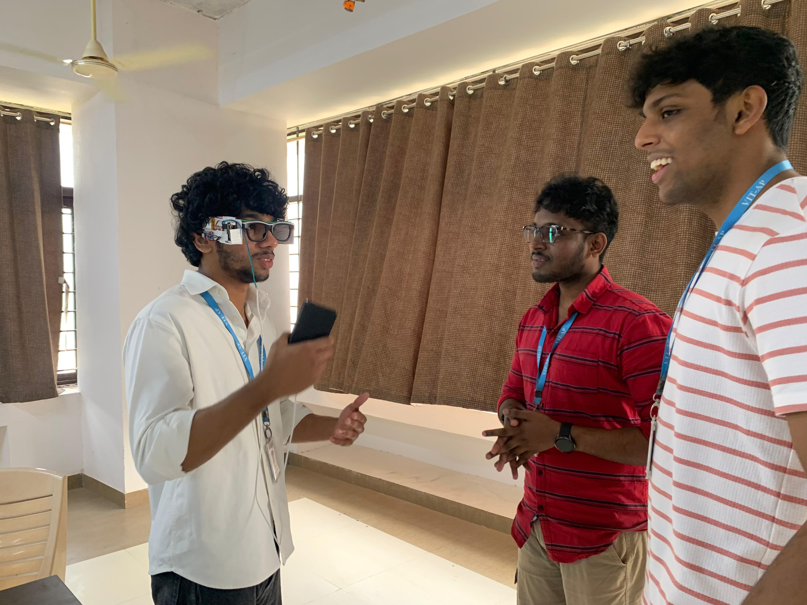
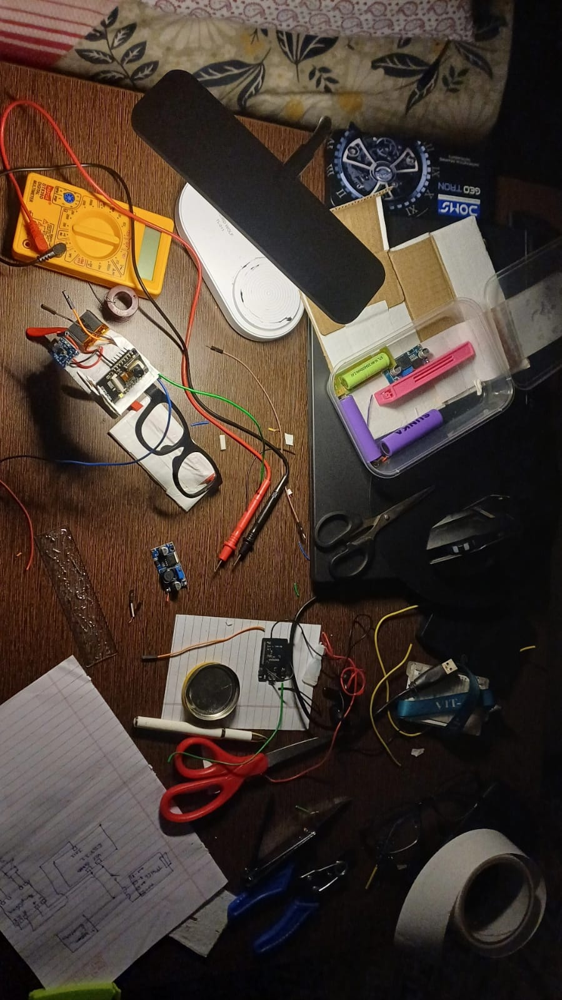
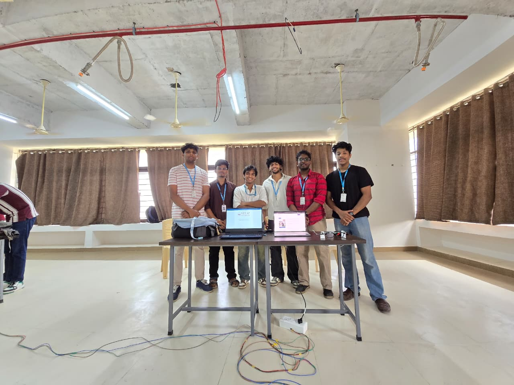

# OCR-Based Assistive Glasses

A wearable prototype that uses an ESP32-CAM and computer-based optical character recognition to help turn text in the surrounding environment into speech.



## Project overview

This team project explores a way to make printed text more accessible. An ESP32-CAM mounted on glasses sends video over Wi-Fi to a computer. The project report describes using PaddleOCR to recognize text, translating the result into Hindi, and converting it to speech for audio playback.

The project is a prototype; its performance and suitability for independent use have not been independently verified.

## Features

- Wearable camera using an ESP32-CAM
- Wireless video transmission to a computer
- Text recognition with PaddleOCR
- Translation using the `deep_translator` library, as described in the report
- Speech synthesis and audio playback

## System architecture

```text
ESP32-CAM → Wi-Fi video stream → Computer / OpenCV → PaddleOCR
                                                       ↓
                                 Audio playback ← Text-to-speech ← Translation
```

The project report describes capturing a frame from the video stream, extracting text, translating it into Hindi, and generating a WAV file for playback. The summary also describes a still-image approach and a live-stream alternative. Exact data flow and configuration should be checked against the implementation.

## Hardware and software

| Component | Described role |
| --- | --- |
| ESP32-CAM with OV2640 | Captures video and connects over Wi-Fi |
| Battery and power conversion | Portable power for the prototype |
| Audio amplifier and earphone or speaker | Audio output |
| OpenCV | Video capture and image processing |
| PaddleOCR | Text detection and recognition |
| deep_translator / GoogleTranslator | Translation, as described in the report |
| Groq TTS | Speech synthesis, as described in the report |

The supplied documents describe different amplifier models and power configurations. The final hardware configuration is not confirmed; consult the original documents and check the physical prototype before reproducing it.

## Project photos

### Prototype development



### Team demonstration



## Repository contents

```text
Docs/     Project report and project summary
Images/   Prototype, demonstration and team photos
```

No standalone source code was supplied with these files. The report contains a code section, but an independently runnable implementation and setup instructions have not been verified.

## Documentation

- [Project report](Docs/project%20report.docx)
- [Project summary](Docs/ESP32_CAM_PaddleOCR_Project_Summary_Updated.pdf)

## Team

- Adithya Mohanan
- Devanand M
- Aswin M
- Yeadhu Krishna P
- Abhinav SP
- V Raj Narayanan

**Project guide:** Prof. Tauseef Khan, VIT-AP University

## Skills demonstrated

Embedded systems, camera interfacing, wireless communication, computer vision, optical character recognition, translation, speech synthesis, and wearable prototyping.
